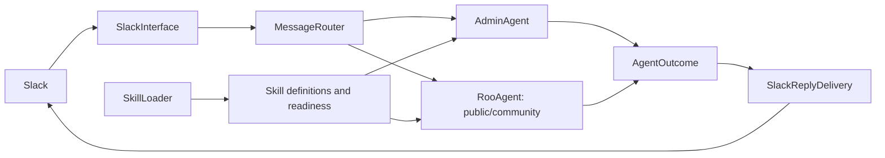

# Modular Slack, routing, agents, and skills

Status: proposed, revised 23 October 2026 following the user's class design.
This supersedes the earlier service-first proposal in this file. It authorizes
no deployment, external action, or database migration.

## High-level design

The public concepts are **SlackInterface**, **MessageRouter**, **AdminAgent**,
**SlackReplyDelivery**, **SkillLoader**, and **Skill**. Keep the existing RooAgent
as the public/community agent during migration. Agents receive requests and
return outcomes; callers do not separately invoke authorization or a gateway.



This is a logical diagram. Admin execution still occurs in the existing isolated
worker. Presenting one AdminAgent interface must not move Admin credentials or
execution into the Public Roo process.

## Classes and ownership

Proposed paths are relative to `../../src/roo`.

| Class | Proposed module | Owns | Does not own |
| --- | --- | --- | --- |
| `SlackInterface` | `slack/interface.py` | Signature/replay verification through existing helpers, context allowlists, bridge actor resolution, event normalization, addressing, receipt lifecycle, dispatch to router and reply delivery | Agent selection rules, domain authorization, skill execution |
| `MessageRouter` | `messages/router.py` | Select the appropriate agent from registered agent descriptions, preserve clarification/no-route decisions, invoke that agent, return its outcome | Slack posting, Admin credentials, executing domain actions |
| `AdminAgent` | `agents/admin.py` | Public `handle(request)` entry point for Admin requests; coordinate authorization, its own capability selection, execution and result validation through internal collaborators | Slack ingress/posting or exposing its services to callers |
| `RooAgent` | existing `agent.py` initially | Public/community skill selection, thread context and execution | Admin eligibility and transport after migration |
| `SlackReplyDelivery` | `slack/replies.py` | Post validated outcomes, preserve blocks/threading/suppression/progress attachments, return delivery status | Rerouting or repeating executed actions |
| `SkillLoader` | existing `skills/loader.py` | Discover, parse, validate and bind permitted skill packages; produce explicit load/readiness results | Per-user authorization or choosing a skill for a message |
| `Skill` | `skills/models.py` | Validated skill definition: identity, purpose, routing exclusions, actions/input schema, policy requirements, readiness and explicit execution binding | Credentials, Slack transport, global mutable state |

`MessageRequest` and `AgentOutcome` are small immutable data contracts, not more
orchestration classes. Input normalization can be constructor functions owned by
adapters. A separate MessageRequestFactory or MessageService class is not needed.
Use an `Agent` Protocol with `handle(request) -> AgentOutcome` for injection and
tests; do not introduce an inheritance framework.

## How routing works

Agent selection and skill selection are different decisions. MessageRouter owns
which agent receives the request; the selected agent owns which of its skills
can fulfill it. An agent being selected does not grant permission.

Do not add a second model call by default. Initially adapt the current single
router decision into a typed selection containing agent identity and an optional
validated skill/action hint. Public skill selections go to RooAgent; the existing
Admin Brain selection goes to AdminAgent. Agents validate any forwarded hint
against their own enabled capabilities and policies. A hint carries no authority.
A separate agent-level classifier can be evaluated later if capabilities grow.

Retain existing ambiguity rules, including mixed Admin-memory/public-action
requests. An Admin denial or outage must not silently reroute to public chat.
Preserve exact-command routing, room-choice continuations, and special durable
workflows through explicit adapters before changing their ownership.

## Inside AdminAgent

Callers use only:

```python
outcome = await admin_agent.handle(request)
```

Internally it composes small collaborators as needed:

- **Authorization service:** checks verified request identity and backend
  eligibility. Backend resource authorization remains authoritative.
- **Execution transport:** reuses AdminDispatchClient and signed, expiring,
  replay-protected envelopes to reach the isolated worker.
- **Capability execution service:** runs the existing read-only organisational
  memory query in the worker using its Admin credentials and permissions.
- **Result validation/rendering:** checks destination identity and preserves
  existing warnings and error messages before returning an AgentOutcome.

There is no caller-facing Gateway step. The public process holds an AdminAgent
facade with only eligibility and dispatch dependencies. The isolated worker owns
local Admin execution services and validates dispatch before invoking them.
Neither side recursively dispatches to itself. These are deployment-specific
compositions behind one logical agent, not two copies of the same workflow.

Use **Admin Agent** for the architecture name. Existing `admin-brain` skill IDs,
API routes, and `ORG_BRAIN_*` settings remain compatibility identifiers until a
separate migration is justified. Renaming the concept must not expand the
worker's current read-only permissions or enable Admin Actions there.

## Skill and SkillLoader design

Evolve the existing Skill dataclass rather than creating an unrelated system.
Separate three questions explicitly:

1. **Enabled:** is this skill permitted in this deployment/agent?
2. **Ready:** did its package load correctly and are required local dependencies
   and configuration available? Do not require live external probes at startup.
3. **Authorized:** may this verified actor perform this action on this resource?
   Evaluate this at request time, independently of loading and model selection.

SkillLoader returns loaded definitions plus structured failures with package,
reason and status. Reject duplicate identifiers. Validate default and explicitly
configured required skills consistently. A required broken package fails startup;
optional packages must be explicitly classified and reported unavailable. A
client import failure must not leave an executable-looking skill registered.

Parse/validate metadata and apply the deployment allowlist before importing
executable client modules. Bind each skill to an explicit executor or a declared
text-only handler; an unknown action skill must not silently become generic chat.
Keep existing backend permission checks while gradually making action policy
requirements explicit. `requires_auth` alone does not describe resource access.

The router and capability descriptions consume the same validated catalogue,
including exclusions and availability. A readable description is not evidence
that a user can execute the skill. Admin execution definitions stay private;
Public Roo receives only the allowed routing description for Admin Agent.

## Request, outcome, and trust boundaries

MessageRequest carries source, request ID, text/files, message timestamp,
addressing mode, continuation data and reply destination. Reuse the existing
BackendActorContext for verified identity, with server-assigned provenance.
Unverified requester references remain separate; supplied Slack-shaped IDs never
become verified identities merely through normalization.

Resumption must preserve identity evidence and recheck eligibility. When legacy
pending state lacks evidence, require a fresh authenticated request. Retain a
scoped ContextVar compatibility adapter for old clients while new services take
identity explicitly; bind None for unverified requests and test concurrency.

AgentOutcome separates conversation, needs-input, denied, unavailable, failed,
and verified completion. Retain an explicitly unspecified legacy state during
migration rather than treating every existing success flag as completed work.
DeliveryOutcome independently records posted, suppressed, not-requested or failed.
Delivery failure must not cause a mutation to execute again.

Keep signatures, replay protection, backend authorization, source/destination
matching, Public/Admin credential separation and public-channel warnings. Build
services in application composition/lifespan; retain get_agent only as a
transitional compatibility adapter. No new service deployment is proposed.

## Incremental delivery

1. **AdminAgent interface and internals.** Wrap current eligibility/dispatch in
   AdminAgent.handle and extract the worker's Admin handler from SkillExecutor
   into an internal execution service. Preserve outputs and read-only scope.
2. **Skill and SkillLoader.** Add explicit load reports, duplicate rejection,
   required/default validation and execution bindings. Cover missing/malformed
   packages, failed imports, disabled packages and optional unavailable skills.
   Keep permission behavior unchanged while documenting its action requirements.
3. **MessageRouter.** Move agent selection out of RooAgent behind the new class,
   reusing current model routing. Validate agent/skill hints; preserve clarification,
   exact commands and denied/unavailable behavior. Avoid extra model calls.
4. **SlackInterface and SlackReplyDelivery.** Extract the normal mention/DM path
   first. Normalize typed requests and consolidate reply posting. Retain adapters
   for internal API, bridge and resumption without upgrading their authority.
5. **Remaining special paths.** Migrate commands, approvals and callbacks one at
   a time, preserving workflow precedence and durable receipt ownership.

Each step is independently reviewable and revertible. Preserve user wording and
existing authorized behavior; new capabilities, dependency updates and durable
schema redesign are separate tasks. No broad executor rewrite is required.

## Verification

Use fake backends and transports. Test denied eligibility, outages, invalid or
replayed dispatch, mismatched destinations, concurrent actor isolation, and
unverified internal API identities. Verify agent selection cannot grant access,
and Admin failures do not fall back to public chat. Preserve threading, blocks,
suppression, progress attachment and response-only API behavior.

Test loader defects independently of model routing. Keep capability honesty
evals to check that available/unavailable descriptions reach responses correctly.
Preserve ignored/duplicate/retryable events and durable handoff transitions.
Inspect fixtures before executing database-backed tests; schema initialization
still needs specific migration approval. Do not start application services or
use live credentials for routine refactor tests. No database migration is planned.
