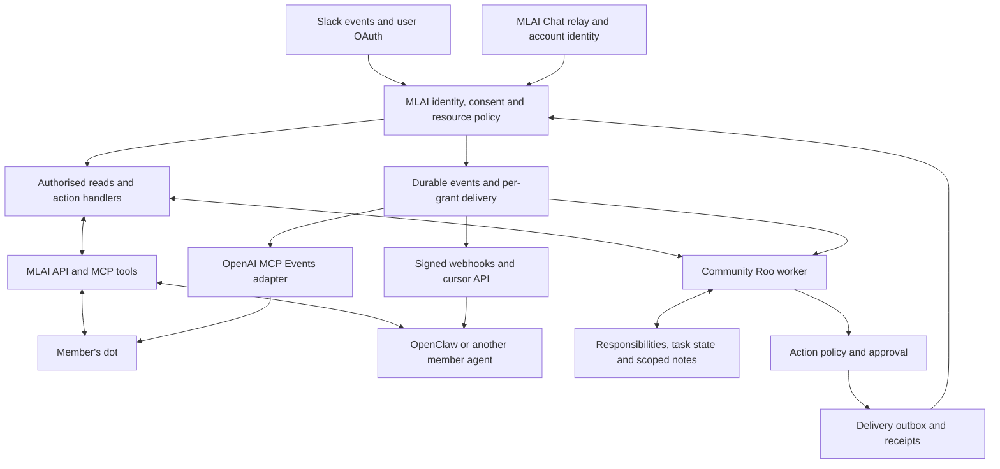

# Proactive Roo and member-owned agents

Implementation follow-up: Hermes was selected. See the [source implementation and remaining rollout gates](../roo/proactive/README.md) and [host operations guide](../hermes/OPERATIONS.md). The research below records the findings as of 5 October 2026.
Research and proposed implementation plan · 5 October 2026

Status: planning only. Public documentation and local source were inspected; deployed services and account eligibility were not tested. Existing uncommitted work was treated as provisional. No runtime configuration, account settings, external messages, or database migrations were changed.

Follow-up research on execution environments and authentication is in [Roo's computer: Hermes, OpenClaw, OpenAI dots and Grok Bot](roo-computer-runtime-comparison.md). For computer-capable work, it recommends evaluating an isolated Hermes worker first, while preserving the permission architecture below.

## Recommendation

Keep Roo as MLAI's official community agent. Give it persistent responsibilities, reliable wake-ups, task state, and a controlled way to notify or act. Let members connect their own dots, OpenClaw instances, or other agents through a separately authorised MLAI interface.

**OpenClaw is optional.** The hardest shared requirement is enforcing community permissions across reads, events, memory, and actions. That belongs in MLAI's backend regardless of which agent runtime is used.

There are three distinct identities:

| Identity | Purpose | Authority |
| --- | --- | --- |
| Community Roo | Community support and explicitly assigned community responsibilities | Reviewed service permissions and allowed channels |
| A member's agent | Work for that member, using their chosen provider/runtime | A revocable subset of the member's current permissions |
| Admin Roo | Committee and operational responsibilities | Separate administrative configuration and credentials |

A member's dot supplements Roo. It does not replace the shared community service. A community-visible Roo conversation must not become a route into private member-agent memory or administrative tools.

The plan covers Slack and MLAI Chat. Verify the intended production surface before implementation: the local backend README calls Buzz/MLAI Chat an inactive experiment, while MLAI Chat contains substantial agent functionality and a deliberately paused community-agent rollout. Those findings establish code availability and rollout constraints, not deployment status.

## What OpenAI dots actually provide

Dots are cloud-hosted personal agents that keep work moving between conversations. The documented experience includes saved context, parallel background work, a cloud computer, and continued work while the user's computer is off. Supported plugins and connected accounts supply tools. I found no documented distribution for self-hosting the dot product itself in the official sources reviewed. This is a limit of the verified documentation, not a claim that no future offering could exist. [OpenAI: Meet dots](https://learn.chatgpt.com/docs/dots)

Assigned work can wake on a time or a supported event. Dots also perform proactive read-only research; acting on findings is a separate permission decision. Their notes are distinct from a full transcript and from ChatGPT's saved memory. These are useful product behaviours to reproduce in Roo. [OpenAI: Tasks and memory](https://learn.chatgpt.com/docs/dots/tasks-and-memory)

The user can review activity and schedules, set action boundaries, and stop work. Pausing the main dot does not automatically stop delegated work or future schedules. Roo should offer an explicit “stop my MLAI agent activity” control whose effect covers MLAI-managed workers, schedules, subscriptions and queued deliveries. External agents' independent work requires their provider's stop controls. [OpenAI: Controls](https://learn.chatgpt.com/docs/dots/controls)

| Capability to reproduce | Proposed Roo implementation | Priority |
| --- | --- | --- |
| Remember an ongoing responsibility | Durable task with owner, scope, objective, sources, notification policy, and expiry | First release |
| Notice relevant changes | Authorised event ingestion plus a recovery scan | First release |
| Follow up later | Persisted next wake time and restart-safe worker claims | First release |
| Tell me only when useful | Deduplication, quiet hours, meaningful-change detection, notification budget | First release |
| Act within my instructions | Server-enforced scopes and approved action intents | Drafts first; bounded writes later |
| Keep context across conversations | Provenance-aware task notes partitioned by owner and audience | First release |
| Work on several things | Bounded background jobs with independent status and cancellation | After initial workflows |
| Cloud browser, computer use, voice, rich personal assistant | Isolated execution environments and additional product work | Separate later scope |

The initial goal should be equivalent ongoing community workflows. Full parity with dot's browser, voice, account integrations, and general-purpose computer would be a substantially larger product.

### A direct route for members' dots

There are two verified integration paths:

1. **Native Slack participation.** A member connects their dot to Slack, adds it to an approved channel, and explicitly assigns monitoring. Channel membership alone does not establish a monitor. The enterprise guide says only the owner can initiate dot work through Slack; other participants' messages can supply context. Account eligibility, Slack app approval, and workspace controls still apply. [Messaging](https://learn.chatgpt.com/docs/dots/channels), [workspace administration](https://learn.chatgpt.com/docs/enterprise/dots-admin-guide)
2. **An MLAI plugin with tools and events.** Dots can use supported installed plugins. An OAuth-protected MLAI MCP server can provide account-scoped reads and actions; the plugin should be tested with real eligible dots before claiming compatibility. [Dot apps](https://learn.chatgpt.com/docs/dots/computers-and-apps), [plugin authentication](https://developers.openai.com/plugins/build/auth), [plugin testing](https://developers.openai.com/plugins/deploy/connect-chatgpt)

Crucially, OpenAI now documents **MCP Events** for dots and Work Cloud. It requires MCP 2.0, protocol `2026-07-28`, and a draft Events extension. ChatGPT discovers events, subscribes with filters and a callback, and receives signed webhook deliveries. Its integration does not support the extension's polling, streaming, `gap`, or `terminated` notifications. This makes “a new MLAI message wakes my dot” a documented integration target, subject to an end-to-end compatibility test. [OpenAI: MCP Events](https://developers.openai.com/plugins/build/mcp-events)

Provide a separate portable event API for clients that do not implement this extension. Generic MCP tool support does not establish background wake-up compatibility.

Native dot–Slack connections and direct Slack MCP connections bypass the MLAI gateway. They are useful capability/experience pilots under Slack and provider controls. Revoking an MLAI grant cannot revoke a separately connected Slack account or cancel that agent's own schedules. Use the custom MLAI plugin for the centrally enforced delegation contract, and expose any separate connections clearly in rollout guidance.

## What MLAI already has

The following evidence is from the local checkouts, not a production audit. Local file links intentionally identify the inspected source.

| Existing foundation | Implication and gap | Evidence |
| --- | --- | --- |
| Self-hosted Python/FastAPI Roo, separate Public/Admin surfaces, configurable providers | Retain business logic and established action boundaries | [Roo README](../../README.md) |
| Jobs, payment reminders, timesheet and client-report workers | Roo already supports proactive operations; generalise deliberately rather than adding a second owner for existing schedules | [Scheduled jobs](../../README.md), [payment reminders](payment-reminders.md) |
| Contextual Slack responses | Reacting without a mention is already present; this differs from durable responsibilities that wake later | [Contextual responses](contextual-slack-responses.md) |
| Backend owner-scoped Slack OAuth, consent generations, membership checks and cache fencing | Reuse permission logic, with a new agent grant; do not expose service or upstream tokens | [Authority checks](https://github.com/MLAI-AUS-Inc/mlai-backend/blob/main/integrations/services/slack_dm_mirror.py#L458), [owner token calls](https://github.com/MLAI-AUS-Inc/mlai-backend/blob/main/integrations/services/slack_dm_mirror.py#L539), [cache](https://github.com/MLAI-AUS-Inc/mlai-backend/blob/main/integrations/services/slack_dm_mirror.py#L666) |
| Private Slack mirroring to verified member devices | Existing consent deliberately excludes Roo and wider organisational processing; it is not third-party-agent consent | [Mirror contract](https://github.com/MLAI-AUS-Inc/mlai-backend/blob/main/docs/community-chat-roo-dm.md), [Chat import contract](https://github.com/MLAI-AUS-Inc/mlai-chat/blob/main/docs/mlai/SLACK_CHAT_IMPORT.md#L60) |
| MLAI Chat agent harness, OpenClaw preset, ACP heartbeat and workflow schedules | Significant reusable runtime work exists | [Chat README](https://github.com/MLAI-AUS-Inc/mlai-chat/blob/main/README.md), [heartbeat](https://github.com/MLAI-AUS-Inc/mlai-chat/blob/main/crates/buzz-acp/src/lib.rs#L2277), [scheduled-fire claim](https://github.com/MLAI-AUS-Inc/mlai-chat/blob/main/crates/buzz-workflow/src/lib.rs#L467) |
| Community-agent rollout intentionally paused | Releasing community agents requires a deliberate product decision and eligibility checks | [Rollout policy](https://github.com/MLAI-AUS-Inc/mlai-chat/blob/main/docs/mlai/COMMUNITY_AGENT_ROLLOUT.md#L1), [enforcement](https://github.com/MLAI-AUS-Inc/mlai-chat/blob/main/desktop/src-tauri/src/community_agent_policy.rs#L5) |
| NIP-OA ownership attestation and stored agent owner | Ownership is useful identity evidence; resource access still checks the agent's own key/membership | [Relay ownership](https://github.com/MLAI-AUS-Inc/mlai-chat/blob/main/crates/buzz-relay/src/api/mod.rs#L84), [ACL evaluation](https://github.com/MLAI-AUS-Inc/mlai-chat/blob/main/crates/buzz-auth/src/access.rs#L71), [channel visibility](https://github.com/MLAI-AUS-Inc/mlai-chat/blob/main/crates/buzz-db/src/channel.rs#L810) |
| Backend persisted job workers and stronger org-memory lease patterns | Reuse worker patterns, not private memory authority; the jobs queue does not yet provide full killed-worker recovery | [Runtime constraints](https://github.com/MLAI-AUS-Inc/mlai-backend/blob/main/docs/backend-runtime.md#L28), [work leases](https://github.com/MLAI-AUS-Inc/mlai-backend/blob/main/org_memory/runtime.py#L290) |

Do not describe the existing ACP heartbeat as fully durable task recovery: its event queue/cursors include in-memory state. Persisted workflow fire claims are a stronger foundation for scheduled work, but they do not by themselves prove end-to-end message recovery or delivery. [ACP queue](https://github.com/MLAI-AUS-Inc/mlai-chat/blob/main/crates/buzz-acp/src/queue.rs#L137), [relay cursor](https://github.com/MLAI-AUS-Inc/mlai-chat/blob/main/crates/buzz-acp/src/relay.rs#L993)

The current checkout also contains an uncommitted MLAI Chat topic-action bridge. Its internal service credential and narrowly reviewed actions are useful architectural context, but it is not a public delegated-agent API or a verified released capability. [Topic-action contract](chat-topic-actions.md)

## Runtime decision: extend Roo; keep OpenClaw optional

| Option | What it contributes | What MLAI still must build | Recommendation |
| --- | --- | --- | --- |
| Extend existing Roo workers | Existing Python code, integration logic, and action gates | General task state, event handling, owner delegation, activity UI | Preferred starting point |
| Add OpenAI Agents SDK inside Roo | Agent loop, tools, handoffs and review integration under application control | Scheduling, community policy, persistence and deployment decisions | Use only where it reduces existing custom orchestration |
| OpenAI Agents API | Managed Codex harness, persistent sessions, compaction and subagents; optional self-hosted execution sandbox | Community permissions, event/task policy and product UI | Viable managed alternative if self-hosted orchestration is negotiable |
| OpenClaw as an isolated Roo worker | Heartbeats, schedules, memory, integrations, MCP tools | MLAI permission gateway and business-specific behaviour | Optional comparison prototype |
| Members run OpenClaw | Member-controlled runtime/model and personal memory | MLAI connection, scoped grants and compatibility guide | Good reference BYO client |
| Replace Roo wholesale with OpenClaw | Broad general assistant runtime | Rebuild or port existing integration and security boundaries | Not justified by proactivity alone |

OpenAI's SDK runs in the application; its Agents API runs a managed harness. The latter's “self-hosted sandbox” does not mean a self-hosted control plane: current documentation states US-only residency and no Zero Data Retention for Agents API sessions. This is relevant if Australian hosting is intended to cover more than MLAI's own infrastructure. [Runtime comparison](https://developers.openai.com/api/docs/guides/agents), [Agents API](https://developers.openai.com/api/docs/guides/agents-api/overview), [SDK](https://developers.openai.com/api/docs/guides/agents/sdk)

OpenClaw is MIT licensed and self-hostable. It documents heartbeats, persisted schedules, inbound webhooks, durable notes, and native MCP clients. Its scheduler requires the Gateway to run and has explicit missed-run recovery behaviour. Its MCP client and a proactive webhook are separate capabilities. [Repository](https://github.com/openclaw/openclaw), [heartbeat](https://docs.openclaw.ai/gateway/heartbeat), [scheduler persistence](https://docs.openclaw.ai/automation/cron-jobs/how-it-works), [webhooks](https://docs.openclaw.ai/automation/cron-jobs/webhooks), [memory](https://docs.openclaw.ai/concepts/memory), [MCP](https://docs.openclaw.ai/tools/mcp)

Its security model assumes one trusted operator or team per Gateway. A session per member in one shared Gateway is not isolation between mutually untrusted members. Experimental Fleet provides separate tenant containers but still leaves substantial hosting product work. If embedded, use its documented supervised executable/Gateway interface as a replaceable worker. [Trust model](https://docs.openclaw.ai/gateway/security/trust-model), [multi-tenant hosting](https://docs.openclaw.ai/gateway/multi-tenant-hosting), [embedding](https://docs.openclaw.ai/gateway/embedding)

“Self-hosted” should be an explicit choice:

- **Recommended first:** MLAI hosts identity, data access, schedules, workers, task state and audit; selected model APIs perform inference.
- **Fully local inference:** add evaluated local models and the required compute. OpenClaw supports local model servers, but tool reliability and cost must be measured on MLAI tasks. [Local models](https://docs.openclaw.ai/gateway/local-models)
- **Member-owned runtime:** each member hosts or purchases their agent; MLAI operates only its access boundary and community Roo. Content sent to a cloud agent is still processed outside MLAI even when the gateway is hosted locally.

## Proposed architecture

All content access and side effects pass through the policy boundary. Admin Roo remains separately configured and is omitted from this community diagram intentionally. No `ORG_BRAIN_API_KEY` or equivalent administrative credential goes into Public Roo or a member runtime.

### A persistent responsibility in Roo

Example: “Watch the events-planning channel for the next month. Keep a private list of unanswered venue questions. Tell me when an answer is overdue; draft reminders for review.”

Represent that as explicit durable state: owner/service principal, objective, allowed resources, grant ID, trigger, last processed cursor, next wake, deadline, quiet hours in `Australia/Melbourne`, permitted actions, budget, notification destination, last notified state, and cancellation status.

One worker path handles timers and incoming events:

1. Store the event/task before acknowledging its admission; deduplicate its source ID.
2. Claim work using a lease/fencing mechanism. Revalidate the relevant grant and current access.
3. Retrieve only relevant authorised context. Treat message text as data, never as authority to widen scope.
4. Produce a bounded outcome: no change, updated private notes, a suggestion, an action draft, or an already-authorised action.
5. Recheck permission and audience immediately before execution or delivery. Bind approvals to exact action parameters and an expiry; changes require fresh review.
6. Record the outcome, enqueue delivery, and persist the next wake or completion state.

Suggested lifecycle: pending → running → waiting for input / waiting for time / succeeded / failed / cancelled. Retries are bounded and visible. Cancellation invalidates pending actions and deliveries as well as future schedules. An ambiguous external send must enter reconciliation rather than being blindly repeated; an outbox does not guarantee exactly-once effects at Slack.

Start with supervised Python workers and durable backend records using existing proven lease patterns. There is no inspected Celery installation to assume. Avoid introducing a separate workflow platform initially; revisit if long-running approvals, scale or operational complexity warrant it. The existing backend remains owner of schedules it already owns.

### A member connecting an agent

The intended user flow is:

1. Open **Connected agents** in the MLAI account interface.
2. Connect a dot/plugin, OpenClaw or another compatible client; sign in to MLAI through OAuth.
3. Choose channels, read/history scope, optional monitoring, expiry, and later write permissions. Show the provider that will receive content.
4. See the named agent, owner, scopes, activity and last use. Revoke it independently from other agents or the Slack connection.
5. In the agent, request a responsibility such as “Tell me when a relevant volunteer opportunity appears in these channels.”

For a pilot, provide `get_profile`, `list_channels`, `search_messages`, `read_thread`, and `get_events_since`. Return canonical source links. Add `search`/`fetch` compatibility wrappers only if targeting OpenAI company-knowledge/research workflows. [MCP integration guidance](https://developers.openai.com/api/docs/mcp)

Later add draft/preview and attributed `post_reply` operations. Keep subscription configuration distinct from content reads and public posting. Do not expose raw SQL, arbitrary Slack API calls, runtime configuration, arbitrary URLs, or a tool-supplied “act as user” identifier.

## What “same permissions as the user” should mean

The agent can be granted up to the member's access for supported capabilities, with a narrower default:

`effective access = current member access ∩ explicit agent grant ∩ community automation policy ∩ source-service access`

Resolve the owner from authenticated credentials, not a model-supplied ID. Enforce the intersection in code for every channel listing, message, thread, search snippet/count, attachment, export, memory retrieval, event delivery and write. A revoked member must not retain access through a still-valid JWT, a queued task, a cached result or an old subscription.

Use an `AgentInstallation` and separately revocable grant per member/client installation. Store the canonical MLAI user, agent identity, allowed capabilities/resources, expiry, consent version and revocation generation. Tokens target the MLAI resource server; the backend keeps any separately authorised Slack credentials. Public Roo, Admin Roo and member agents retain distinct principals.

Use OAuth authorisation-code flow with PKCE, protected-resource discovery, issuer/audience validation, exact callbacks and token rotation. Prefer Client ID Metadata Documents or registered clients; retain legacy registration only where required by tested clients. The current MCP spec deprecates DCR, while OpenAI still documents compatibility support. Pin tested protocol versions instead of assuming every MCP client has the same behaviour. [MCP authorisation](https://modelcontextprotocol.io/specification/2026-07-28/basic/authorization), [MCP security](https://modelcontextprotocol.io/docs/2026-07-28/tutorials/security/security_best_practices), [OpenAI OAuth details](https://developers.openai.com/plugins/build/auth)

Read access is not automatic delegation of posting, moderation, payments or account administration. A committee member's personal agent should not inherit Admin Roo authority by default. If later supported, administrative delegation needs its own explicit grants and reviewed tools.

Every action records both the responsible human and the acting agent. Prefer visible “Sam's agent” attribution with a link to its owner. Check the actual source platform's attribution mechanisms during implementation; do not assume Slack can display arbitrary identities.

### Slack-specific constraints

Slack bot permissions and a human's user-token permissions are different. Bot history access is bounded by the bot's conversations; a user token can access the user's private conversations and public-channel history subject to scopes. Roo's bot token cannot reproduce each member's visibility. Use the member's authorised backend connection where needed. [Slack tokens](https://docs.slack.dev/authentication/tokens/), [history access](https://docs.slack.dev/reference/methods/conversations.history/)

Slack also offers an official MCP server using user OAuth. It currently requires an internal or Marketplace app with a registered identity, and excludes unlisted apps; client and workspace compatibility must be checked. This is a useful optional pilot path, not a substitute for MLAI-specific consent and policy. [Slack MCP](https://docs.slack.dev/ai/slack-mcp-server/)

A Slack event delivered to an application is not authorisation to distribute it to every member's agent. Acknowledge promptly, then enqueue and filter per recipient. Prefer events plus bounded backfill to per-agent history polling; history rate limits depend on the app's distribution classification. Verify that classification before sizing. [Events API](https://docs.slack.dev/apis/events-api/), [rate limits](https://docs.slack.dev/apis/web-api/rate-limits/)

### MLAI Chat, Nostr ownership and encrypted content

Existing owner attestation is insufficient for scoped delegation. NIP-OA's documented conditions constrain event kind/creation time, not channel resources; its timestamp conditions do not enforce wall-clock expiry because an agent can backdate events. Add live server-side grants and revocation checks rather than treating a signed ownership claim as a permanent capability. [NIP-OA limitations](https://github.com/MLAI-AUS-Inc/mlai-chat/blob/main/docs/nips/NIP-OA.md#L48)

Bind delegation to the canonical MLAI account and verified agent key. MLAI accounts can have installation-specific keys, so do not assume one permanent human public key. Keep separate agent signing keys and visible attribution. Integrate delegated policy into relay reads, search, writes and subscription fanout; owner membership must be checked on each protected operation, with subscription termination or reauthorisation when access changes. [Identity/key custody](https://github.com/MLAI-AUS-Inc/mlai-chat/blob/main/docs/mlai/ADR-002-identity-and-key-custody.md#L8)

Apply those checks to direct Nostr/CLI traffic as well as MCP/API traffic. Revoking a delegated grant removes the access it supplied; disconnecting an agent installation must also block its other community-managed access paths and active connections. Otherwise, existing NIP-OA admission or independently assigned channel membership could bypass the intended disconnect control.

Encryption adds another boundary. Permission to read does not give an independent agent the keys to decrypt a member-addressed message. Private Slack mirrors are explicitly limited to the member's verified devices, and NIP-59 delivery has recipient-based handling. Never give an agent the user's signing/private key. [Import privacy](https://github.com/MLAI-AUS-Inc/mlai-chat/blob/main/docs/mlai/SLACK_CHAT_IMPORT.md#L60), [gift-wrap handling](https://github.com/MLAI-AUS-Inc/mlai-chat/blob/main/crates/buzz-relay/src/handlers/req.rs#L1168)

For later private-message support, choose explicitly between an owner-controlled local broker that decrypts and exports selected content, separately authorised source-API retrieval, or an audited protocol change producing agent-addressed encrypted copies. Each changes who can read plaintext. For key-sharing designs, rotation is required to stop future decryptability; revocation cannot erase already downloaded plaintext or keys. Keep private mirrors and DMs outside the first pilot.

### Events, memory and revocation

Use a durable event ledger and per-grant deliveries. Proposed event types include `message.created`, `message.updated`, `message.deleted`, and `membership.changed`; exposed payloads and resource identifiers must themselves pass access checks. Prefer minimal payloads and an authorised fetch for full content. If revealing even the existence of a private resource is disallowed, suppress that event entirely.

For OpenAI's adapter, implement the documented discovery/subscription lifecycle, signed callback verification and delivery, expiry/refresh, and persistent subscriptions. Validate HTTPS destinations at connection time, reject private-network destinations and redirects, and protect signing secrets. Recheck access at dispatch and on retries. A successful callback receipt is not proof that the dot completed the requested work. [MCP Events implementation contract](https://developers.openai.com/plugins/build/mcp-events)

For other clients, supply an application-level cursor API and optional signed webhooks. Current MCP transport is stateless; do not base recovery on a legacy SSE session or `Last-Event-ID`. Pin the OpenClaw MCP protocol and tool compatibility separately from OpenAI's event extension. [Current MCP transport](https://modelcontextprotocol.io/specification/2026-07-28/basic/transports/streamable-http)

Namespace Roo notes by owner, task and audience, with source IDs and access provenance. Enforce source access before retrieval and invalidate derived context when access changes. Filter search before returning snippets, counts or citations. Do not give a model an unrestricted corpus and ask its prompt to hide private material.

Revocation must stop refresh, new reads, queued work, subscriptions and pending deliveries through MLAI-managed paths, and invalidate relevant caches. Already-read material in an external agent cannot be reliably recalled by MLAI; provider retention and user-visible consent must reflect that limitation. MLAI can enforce access to its service, not the internal behaviour of every member's self-hosted agent or its separately authorised source-service connections.

## Delivery plan and acceptance gates

These are engineering estimates, not commitments. For two engineers familiar with the code, allow roughly **2–3 weeks for a narrow read-only pilot** and **6–10 weeks for a hardened initial release**. OAuth infrastructure, actual deployment state and SDK compatibility may change this materially. General-purpose cloud computers/voice, encrypted-DM delegation, and hosting a personal agent for every member are separate workstreams.

| Stage | Concrete deliverable | Exit condition |
| --- | --- | --- |
| 0. Resolve deployment and prove clients; about 2–3 days | Inventory production surfaces and existing scheduler owners; freeze protocol versions; specify one channel and 3–5 volunteer participants; native dot/Slack and minimal custom-plugin compatibility spike | Correct owner identity, successful read, successful dot event wake, unsubscribe and revoke demonstrated in an authorised test environment |
| 1. Delegated reads; about 1–2 weeks | Independent agent grants, consent/revoke UI, backend policy interface, channel/thread/search tools, audit | Two test members with different private access cannot cross-read; wrong audience, stale grants, pagination and cache cases fail closed |
| 2. Proactive Roo; about 1–2 weeks, partly parallel | Durable responsibilities, leased worker, minimal authorised memory, recovery scan, outbox, activity/stop controls | Restart resumes work; duplicate events do not duplicate actions; cancelled or revoked tasks do not publish |
| 3. Member-agent events; about 1–2 weeks | Shared event ledger, OpenAI MCP Events adapter, portable cursor/webhook client and OpenClaw guide | Dot and non-OpenAI client each handle new events, replay, expiry and revocation; protocol differences documented |
| 4. Controlled participation and hardening; about 1–2 weeks | Attributed replies, exact-action approvals or bounded standing grants, rate/cost limits, operational runbooks | Malicious messages cannot widen grants; queued writes recheck access; agent-to-agent loops stop; rollback exercised |
| Later, separately scoped | Private sources, hosted personal agents, broader tools, sandboxed browser/computer and voice | Explicit consent/key-custody design and isolated-runtime evaluation accepted |

Stage 0 testing is a future implementation activity requiring the appropriate test accounts and authorised external actions. This research did not connect agents, send Slack messages or change app installations. Schema concepts in this plan are not migration approval; each specific migration must be reviewed and explicitly approved before creation or execution under repository instructions.

The first three workflows should be narrow and measurable:

- **Community Roo:** privately flag unanswered questions in an approved community channel after a configurable interval; draft a helpful response with sources.
- **A member's dot:** monitor selected channels for relevant events or volunteer opportunities and send that member a private update.
- **Existing operational work:** track an explicitly assigned follow-up through completion using current reviewed Roo tools, preserving the existing schedule owner.

Run suggestion-only shadow mode before enabling proactive public replies. New agent-authored messages should not automatically trigger other agents: carry origin and causation IDs, deduplicate work, and require a human trigger or bounded explicitly enabled delegation chain.

### Proposed implementation boundaries

These names are proposed components, not claims that the modules exist:

| Area | Work |
| --- | --- |
| `mlai-backend` identity/policy | Agent installation and grant records, OAuth integration, consent/revoke interface, shared delegated-access evaluator |
| `mlai-backend` source adapters | Reuse Slack owner identity/membership checks; keep mirror and agent consents independent; add ACL-safe retrieval/search |
| `mlai-backend` task/event services | Durable events, responsibilities, leases, deduplicated outbox, delivery receipts and revocation fencing |
| Roo `roo-standalone/roo` | Thin proactive worker/orchestration path, typed outcomes and reviewed tool adapters; preserve router/action gates and separate surfaces |
| API/MCP adapter | Versioned tools, OAuth metadata, stable schemas, OpenAI Events extension adapter, portable event endpoint |
| MLAI Chat, if selected | Account-bound agent grants, owner/agent attribution, delegated relay checks, subscription invalidation and explicit release policy update |
| Account/Chat UI | Connected agents, scopes, activity, pending drafts, revoke and stop-all controls |

Before adopting OpenClaw inside Roo, implement one identical workflow with the same permission API in both runtimes. Compare useful outcomes, notification noise, restart recovery, operating cost and maintenance effort. Adopt only if it reduces total work. Members can still use OpenClaw regardless of that decision.

### Verification and operations

The implementation test matrix should cover:

- Cross-user and cross-workspace access; private channel IDs guessed through tools, search, files and event filters.
- Membership removal, account suspension, grant expiry, token rotation and revocation during pagination, queued jobs, retries and final dispatch.
- Cache and derived-memory access after permissions change; deleted/edited source handling.
- Duplicate, delayed and reordered events; worker crash and lease loss; uncertain external delivery; replay after disconnect.
- Prompt injection in community text, forged owner fields, invalid webhook signatures and callback SSRF attempts.
- A private-to-public disclosure attempt; approvals reused with changed parameters; agent-generated reply loops.
- Dot plugin installation, refresh and event delivery on an eligible real account; OpenClaw compatibility on a pinned release.

Track cost per useful outcome, irrelevant notifications, duplicate sends, permission denials, delivery lag, task failures and user revocations. Suggested pilot targets are zero unauthorised disclosures, zero duplicate public actions, at least 80% of suggestions rated useful by participants, and successful cancellation/revocation tests. These are proposed acceptance targets, not measured results.

Keep feature flags and kill switches per surface, client, grant and write capability. A rollback disables agent event delivery and writes while preserving normal community use. Maintain a dead-letter queue, retry/reconciliation view and a record of which principal authorised each action. Keep audit content minimal and restrict access; do not turn tracing into a second unrestricted message archive.

“Always on” means reliably available and resumable, not constantly running an LLM. For example, a model heartbeat every 15 minutes for 100 members creates 9,600 checks per day before useful work. Filter events cheaply, batch changes, suppress no-change results, and use recovery scans. Budget model tokens, tool calls, runtime and notifications separately. Members' external agents generally carry their own inference charges; MLAI still pays for gateway, indexing, delivery and support. Price the pilot from observed usage rather than an assumed monthly bill.

## Decisions to settle before implementation

1. Which deployed surface leads the pilot, and should the paused MLAI Chat community-agent rollout be reopened?
2. Does self-hosting mean MLAI controls orchestration/storage, or must inference and all processing also stay on MLAI-owned infrastructure?
3. Which channels allow external personal agents, what default history window is reasonable, and who owns the pilot?
4. Which exact actions may Roo or a personal agent perform under standing instructions, and which need a reviewed draft?

Recommended defaults: support both surfaces architecturally; pilot on one approved community channel; self-host MLAI orchestration and policy with configurable model APIs; read-only member grants and private suggestions first; defer private mirrors/DMs and administrative delegation. Build the shared permission interface once, then let Roo and different personal-agent products evolve behind it.
