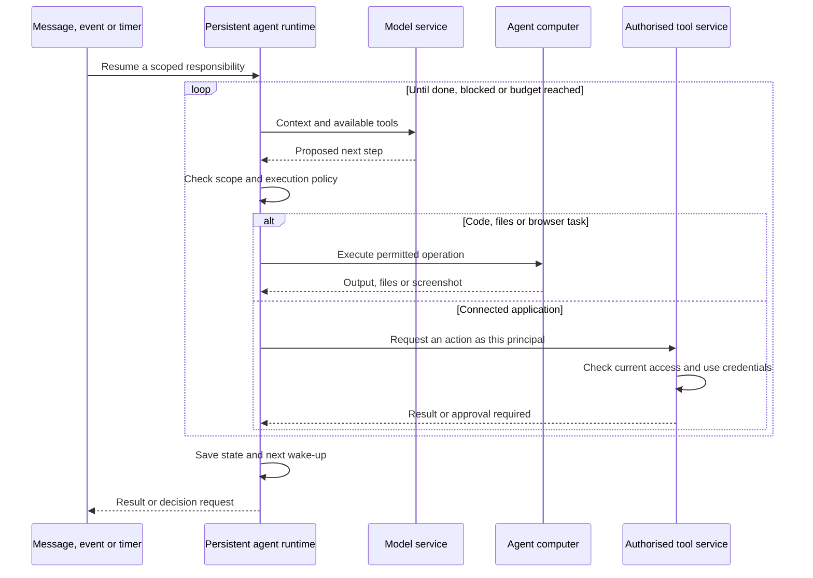
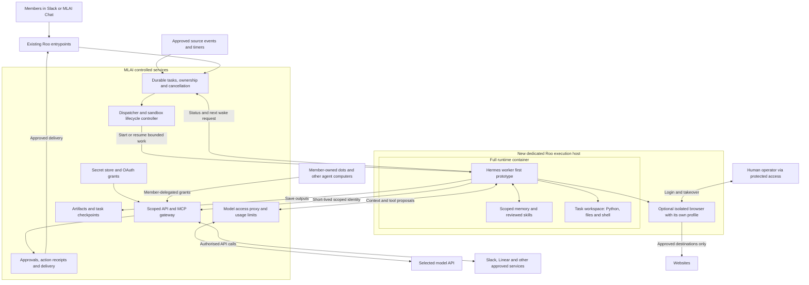

# Roo's computer: Hermes, OpenClaw, OpenAI dots and Grok Bot

Implementation follow-up: Hermes was selected. See the [source implementation and remaining rollout gates](../roo/proactive/README.md) and [host operations guide](../hermes/OPERATIONS.md). The research below records the findings as of 5 October 2026.
Research and proposed architecture · 5 October 2026

Companion to the [proactive Roo and member-agent plan](proactive-roo-and-member-agents-plan.md). Product findings below come from current official documentation and repositories. The proposed Roo architecture is an engineering recommendation, not a description of deployed infrastructure. No agents, cloud machines, accounts or integrations were provisioned during this research.

## Recommendation

**Give Roo a dedicated, isolated execution environment, and prototype Hermes Agent as its worker first. Keep the existing Roo/MLAI services responsible for identity, source permissions, task admission and external actions.** OpenClaw is a credible alternative, particularly if its existing MLAI Chat integration and operator interface save more work in the prototype.

Here, Hermes means Nous Research's Hermes Agent. Grok Bot means the actual persistent-computer product, not the `@grok` account on X or an xAI model API call.

A computer is not required for scheduled API calls or message monitoring. Roo already runs on a computer: its existing container hosts the FastAPI service, application dependencies and data volumes. What it lacks is a deliberately isolated environment where an agent can run arbitrary task code, manipulate files and operate a browser. Do not add that authority to the current application container, which loads Roo's service configuration. [Current Compose deployment](../docker-compose.yml), [current image](../Dockerfile)

For the first implementation, use a Linux VM with a contained runtime, a task workspace, and optional browser service. There is no requirement for a physical Mac or Windows desktop. A GPU is unnecessary when inference uses a model API; hosting inference locally is a separate capacity decision.

## The pieces behind an agent's computer

These are separate responsibilities, even when a product bundles them:

| Component | What it does | What should persist |
| --- | --- | --- |
| Agent runtime | Calls a model, interprets tool requests, manages context and work | Scoped memory, session/task references, reviewed skills |
| Wake-up service | Starts or resumes work after an event, timer or user message | Responsibilities, schedules, cursors, retries, cancellation |
| Execution environment | Runs code, command-line tools and document/data processing | Selected project files and artifacts; scratch space can be disposable |
| Browser or desktop | Navigates sites, interacts with interfaces, supports human takeover | Only deliberately saved profiles; cookies are credentials |
| Authentication service | Connects the right identity to the right service | Encrypted credentials, grants, expiry and revocation records |
| Policy and delivery service | Checks resources/actions and publishes approved results | Action receipts, approvals, audit and delivery status |

The following is a conceptual execution loop common to this category, not a claim about undocumented internal implementation:



The model is usually remote. The runtime drives the computer and feeds results back to the model. Reliable autonomy comes from the runtime, saved state, triggers and permissions together; attaching a terminal alone does not produce it.

## What each product does

| Product | Who operates the computer? | How work persists | Authentication model | Fit for self-hosted Roo |
| --- | --- | --- | --- | --- |
| OpenAI dot | OpenAI cloud computer; optional connected personal computer | Ongoing responsibilities, notes, background tasks and schedules | Connected plugins plus independent browser sign-ins | Product reference; no self-hosted dot distribution established in reviewed docs |
| Grok Bot | Cursor-hosted cloud computers | Persistent workspace, personal bots, routines and supported events | Hosted connectors plus browser/CLI sign-ins | Hosted alternative; product explicitly cannot be self-hosted |
| OpenClaw | Operator runs Gateway; tool execution can use separate sandboxes; browser separate | Agent workspace/memory and persisted automation state | Configured provider/channel credentials, MCP auth and browser profiles | Strong candidate, especially for Gateway/browser experience |
| Hermes Agent | Operator runs Python runtime; terminal and browser backends are configurable | Profile memory/skills, sessions, gateway and scheduled work | Provider credentials, MCP authorisation and browser/login integrations | First prototype candidate for an execution worker behind Roo |

This is a suitability comparison, not a benchmark. Both open-source runtimes cover messaging, tools, memory and scheduling; neither automatically implements MLAI's member-level permissions.

### OpenAI dots

Dots have their own cloud computer and browser, independent of the user's laptop. The browser has separate sessions. A human can take over for login; valid website sessions can be reused later. Plugins are another access route and retain their own account permissions. A connected personal computer must remain online with ChatGPT open. Public documentation describes the experience, not a specific hypervisor or container architecture for dots. [Computers and apps](https://learn.chatgpt.com/docs/dots/computers-and-apps)

Dots can maintain responsibilities, wake later, delegate work and use schedules or supported event monitoring. The proactive research capability itself is read-only; subsequent action requires the applicable authority. [Tasks and memory](https://learn.chatgpt.com/docs/dots/tasks-and-memory)

There is also a distinct developer option: the **Agents API**, with an OpenAI-managed harness and a self-hosted executor. Its executor initiates outbound connections, while the application keeps its main API credential outside the environment. This is a managed orchestration alternative, not a downloadable dot. [Self-hosted execution](https://developers.openai.com/api/docs/guides/agents-api/environments/self-hosted)

For hosted API sandboxes, OpenAI documents a vault/proxy pattern where code uses a placeholder and an external proxy adds the real secret for allowed destinations. Self-hosted sandboxes need an equivalent broker supplied by the application. This is a useful design precedent for Roo. [Vaults](https://developers.openai.com/api/docs/guides/agents-api/tools/vaults), [sandbox security](https://developers.openai.com/api/docs/guides/agents-api/environments/security)

### Grok Bot

Grok Bot is a current computer-agent product. Personal bots on one account share files, browser sessions and command-line credentials; separate bot screens do not isolate authority. That is useful for personal handoffs, but unsuitable as the separation between Public Roo, Admin Roo and community members. [Grok Bot overview](https://docs.x.ai/grok-bot/overview)

The documented user boundary is a dedicated Firecracker microVM. The product runs on Cursor-hosted computers in the US; customer-hosted deployment and customer images are explicitly unsupported. Blocking a connector does not block the same website in the browser. [Security FAQ](https://docs.x.ai/grok-bot/security-faq)

Browser login uses a human takeover or secure secret request. The workspace and selected browser state persist, while temporary files and manually installed software should be treated as replaceable. Use a connector when one covers the operation. [Computer and apps](https://docs.x.ai/grok-bot/computer-and-apps)

Routines run on schedules or supported events; event integrations can require a connection separate from the ordinary plugin. [Skills and routines](https://docs.x.ai/grok-bot/skills-routines-and-automations)

**Team Bots** are a relevant hosted comparison: OAuth tools use the requesting person's account, while shared token-based tools expose the bot credential's capability to the team. Personal conversations use the member's computer; shared Slack/group conversations use a separate computer for that Team Bot. Slack participation requires linked, eligible team accounts. This offers a shared-assistant product, but not a self-hostable community runtime. [Team Bots](https://docs.x.ai/grok-bot/team-bots)

### OpenClaw

The Gateway coordinates conversations, tools and agents. Terminal sandboxing is optional and currently off by default. Enabling its Docker sandbox contains selected tool operations; it does not place the Gateway itself inside that sandbox. Elevated execution is another route requiring separate policy. [Sandboxing](https://docs.openclaw.ai/gateway/sandboxing)

The browser is a separate capability. A dedicated profile separates browser state; an actual browser sandbox/container supplies a stronger process boundary. OpenClaw's Control UI has an operator browser panel for watching and interacting with remote browser work. [Browser](https://docs.openclaw.ai/tools/browser), [operator panels](https://docs.openclaw.ai/web/control-ui/panels)

Its shared secret store distinguishes protected secrets from agent-readable environment values. The store is not encrypted at rest; external secret providers are available. An optional destination-bound egress proxy can substitute protected credentials outside agent subprocesses. Agent-readable environment values are still plaintext capabilities. [Secret store and egress](https://docs.openclaw.ai/gateway/secrets/secret-store-and-egress)

Its automation scheduler persists job definitions, state and history. Missed ticks can be coalesced and overdue work rescheduled; a process restart is not a guarantee that a running command survives. [Automation lifecycle](https://docs.openclaw.ai/automation/cron-jobs/how-it-works)

A shared Gateway assumes a trusted operator/team. Native plugins run with Gateway privileges, so installation review and isolation still matter. The documented embedding seam is a supervised executable and Gateway protocol; `openclaw acp` supplies an ACP bridge. MLAI Chat already documents an OpenClaw preset, which is an integration advantage to measure. [Trust model](https://docs.openclaw.ai/gateway/security/trust-model), [plugin architecture](https://docs.openclaw.ai/plugins/architecture), [embedding](https://docs.openclaw.ai/gateway/embedding), [ACP](https://docs.openclaw.ai/cli/acp), [MLAI Chat README](https://github.com/MLAI-AUS-Inc/mlai-chat/blob/main/README.md)

The ACP bridge handles session routing and streaming; it does not support per-session `mcpServers`, and a session key is not authorisation. Bind tool access and grants independently in the backend. MCP and native plugin execution remain Gateway-side, outside terminal sandboxing. [ACP limits](https://docs.openclaw.ai/cli/acp), [sandbox capability matrix](https://docs.openclaw.ai/gateway/sandboxing/supported-capability-matrix)

### Hermes Agent

Hermes is an MIT-licensed agent with persistent memory, reusable/self-improving skills, messaging and scheduled work. Its execution backends include local execution, Docker, SSH, Singularity/Apptainer, Modal, Daytona and Vercel Sandbox. Those are choices for execution, not evidence that all processing automatically occurs inside one selected sandbox. [Overview](https://hermes-agent.nousresearch.com/docs/), [configuration](https://hermes-agent.nousresearch.com/docs/user-guide/configuration/)

The Python runtime exposes programmatic entry points and ACP. For Roo, use a supervised process/sidecar protocol rather than importing the whole agent into FastAPI's privileged process. This preserves independent deployments and makes runtime replacement easier. [Architecture](https://hermes-agent.nousresearch.com/docs/developer-guide/architecture), [programmatic integration](https://hermes-agent.nousresearch.com/docs/developer-guide/programmatic-integration/), [ACP](https://hermes-agent.nousresearch.com/docs/developer-guide/acp-internals)

Hermes supports local and hosted browsers and computer-use backends. Its browser is not implicitly moved into a remote terminal backend. Default local browsing starts with a clean profile; real-profile reuse is opt-in. Some browser modes execute generated code, so place the entire execution path inside the intended boundary. Browser profile persistence depends on the selected backend and needs restart testing. [Browser automation](https://hermes-agent.nousresearch.com/docs/user-guide/features/browser/), [computer use](https://hermes-agent.nousresearch.com/docs/user-guide/features/computer-use/)

Provider keys can come from profile environment files or external secret managers. Hermes documents filtering managed credentials from child-process environments, with declared passthrough for eligible variables; this does not make accessible credential files safe from arbitrary code. Its separate website-login vault encrypts saved values locally and fills exact approved origins; saved logins can work unattended, while missing credentials or interactive challenges need a person. [Secrets](https://hermes-agent.nousresearch.com/docs/user-guide/secrets/), [passwords and logins](https://hermes-agent.nousresearch.com/docs/user-guide/features/credential-vault)

Hermes' security policy explicitly describes a single-tenant agent: allowlisted callers on an adapter are equally trusted, and session names are not capability boundaries. It recommends whole-process containment for untrusted external content. A terminal backend alone does not contain in-process plugins, hooks and other integrations. Current documentation and implementation can differ on individual tool routing; verify the pinned release rather than assuming a tool name proves where it runs. [Security policy](https://github.com/NousResearch/hermes-agent/blob/main/SECURITY.md)

Its documented unattended approval modes default to denying commands that require dangerous-command approval. Preserve that posture; do not enable unattended blanket approval to make a demo appear autonomous. Runtime checks still complement the backend's enforced permissions. [Approval configuration](https://hermes-agent.nousresearch.com/docs/user-guide/security)

An additional integration lead is its **Buzz adapter**: the official guide describes Nostr relay authentication and NIP-OA owner attestation, matching the upstream family used by MLAI Chat. Compatibility with MLAI's fork, policies and paused agent rollout remains untested. Direct relay/CLI traffic would still need the same grant enforcement as MCP/API traffic; this adapter does not solve owner-permission inheritance. [Hermes Buzz](https://hermes-agent.nousresearch.com/docs/user-guide/messaging/buzz), [MLAI rollout policy](https://github.com/MLAI-AUS-Inc/mlai-chat/blob/main/docs/mlai/COMMUNITY_AGENT_ROLLOUT.md)

## Hermes or OpenClaw for Roo?

**I would evaluate Hermes first for a bounded research, analysis and document-producing worker.** The reasons are its Python integration options, selectable execution environments, and documented ACP/Buzz paths. This is an engineering fit assessment; no comparative reliability, latency or cost benchmark has been performed.

**I would favour OpenClaw if its Gateway, existing MLAI Chat preset and browser operator UI substantially shorten delivery.** It can also perform research and code work. Hermes can also be a multichannel assistant; this is not an exclusive feature distinction.

In both cases:

- Keep the existing Roo entrypoints and reviewed action handlers.
- Give the runtime a narrow MLAI workload identity rather than a complete set of production service secrets.
- Keep community-wide memory distinct from private member work. A shared runtime must not accumulate all members' private data in one home directory.
- Keep Public Roo and Admin Roo in separate credential/compute domains. For hosted personal agents, use separate instances/OS boundaries per member rather than profiles alone.
- Treat learned skills as proposed executable changes. Promote them into the production skill set only after review; do not let a community message silently modify tomorrow's shared automation.

## Proposed Roo architecture

This diagram shows the deployment we would build. The task service, scoped worker interface, credential broker and sandbox controller are proposed additions; existing Roo capabilities supply the reviewed integration logic.

The shared worker shown here is for community duties using information approved for the same audience. Private member jobs require a separately isolated runtime, home directory, memory, task files and browser profile for that authority. Separate task directories or conversation IDs inside this shared worker are insufficient. Members bringing their own agents keep their own execution environment and connect through delegated grants.



The browser arrow is a separate access path. A logged-in browser can exercise its site's account authority even if the MCP gateway would reject the same action. Therefore, do not sign this browser into broad Slack, Linear, cloud-console or administrator accounts. Keep supported service operations behind the API gateway. Add authenticated browsing only for a specific missing capability with a restricted account and an explicit workflow policy.

The runtime must not receive the controller's cloud provisioning credentials or the host Docker socket. If local sandbox provisioning requires a privileged service, keep it outside agent-readable execution and expose only a constrained operation contract. A dedicated VM is an outer boundary; constrained task containers inside it reduce accidents and allow clean resets. Containers on a shared kernel are not equivalent to separate microVMs.

In the minimal Hermes deployment, its local terminal runs inside the full runtime container. This isolates it from production Roo, but does not isolate the shell from that container's own accessible files and memory. If a task needs a separate boundary, use a separate execution backend, such as a disposable SSH worker, while retaining containment around the Hermes process itself.

## How authentication should work

| Credential or identity | Where it belongs | What the runtime gets |
| --- | --- | --- |
| Model-provider API key | Model proxy / protected coordinator; separate quota/project | Scoped inference capability, ideally without the upstream key |
| Roo workload identity | Identity service and runtime's short-lived credential channel | Only the tools/resources required for the assigned task |
| Slack/Linear/Google OAuth refresh token | Backend credential store | Tool results; upstream tokens stay outside generated code |
| Human member grant | Backend, tied to member, agent installation and current permissions | A revocable delegated capability; no caller-selected owner override |
| Website session | Dedicated browser profile for one authority domain | Browser control within the approved account's authority |
| Cloud/sandbox provisioning credential | Lifecycle controller outside the agent environment | No raw provisioning credential |
| `ORG_BRAIN_API_KEY` and administrative authority | Separate Admin Roo services | Never provided to Public Roo |

Use organisational service identities for organisational Roo duties where the upstream service supports them. Use member OAuth only when explicitly acting as that member. A display name such as “Roo” is not itself an account or authorisation grant.

Putting a secret into a vault protects storage, but injecting the real value into an environment accessible to arbitrary code exposes it again. A broker that performs the operation, or supplies credentials only to approved destinations, is stronger. Such a proxy does not remove authority: the agent can still use whatever operations the proxy permits. Enforce operation/resource scope and spending limits as well as host allowlists. [OpenAI's documented broker pattern](https://developers.openai.com/api/docs/guides/agents-api/environments/security)

For browser-only services, use an operator takeover to authenticate the dedicated account and complete MFA. Resume only after the operator returns control. Treat cookies, profile exports and snapshots as secrets. An expired login should produce “needs sign-in” status; do not turn the shared Roo computer into a copy of Sam's everyday browser or password manager.

Revocation must cover agent grants, queued actions, active workers, browser sessions and any separately connected upstream account as applicable. Revoking an API grant alone does not revoke a browser cookie or erase already-read information.

## How we would spin this up

### 1. Build a restricted development worker

Provision one dedicated Linux VM in the chosen hosting region. An initial sizing hypothesis is 4 vCPU, 8 GiB RAM and about 50 GiB encrypted disk for one runtime and a small number of browser/code tasks. This is not a vendor requirement or measured capacity result; benchmark and cap concurrency. Model inference remains API-hosted initially.

Build a pinned image with the chosen Hermes release, required Python/Node tools, document libraries and only reviewed integrations. Use the official container approach inside that VM, a non-root account, controlled mounts and enforced outbound network policy. Do not copy the existing Roo `.env`, a developer home directory, cloud credentials, SSH agent socket or Docker socket into the worker. Keep the control surface private. [Hermes Docker guide](https://hermes-agent.nousresearch.com/docs/user-guide/docker/)

Separate these storage classes:

- Runtime image and approved skills: immutable deployment inputs.
- Runtime state: scoped persistent notes/session data, retained according to policy.
- Per-task workspace: bounded inputs, scratch files and output staging; destroyed or reset after completion.
- Artifacts: explicitly saved to durable storage with the task's owner/access labels.
- Browser profiles: separate encrypted storage per authority, introduced only when needed.

Start with synthetic fixtures and unauthenticated research. There is no need to enable browser sign-ins to prove document/code execution.

The reviewed release page identifies `v2026.9.24` / v0.21.5 and the image tag `nousresearch/hermes-agent:v2026.9.24`. Treat that as a reproducible candidate, resolve its immutable digest, and verify the effective configuration before use. Rolling documentation can describe newer features than that release. [Hermes release](https://github.com/NousResearch/hermes-agent/releases/tag/v2026.9.24)

An illustrative configuration subset, **not a complete tested deployment**, is:

```yaml
# Applied inside a fully contained Hermes runtime.
# "local" means this container, not the Roo production host.
terminal:
  backend: local
  cwd: /opt/data/workspace
approvals:
  mode: manual
  cron_mode: deny
  single_query_mode: deny
  unattended_mode: deny
skills:
  write_approval: true
memory:
  write_approval: true
browser:
  use_real_profile: false
```

For a Roo-managed worker, start the documented ACP entry point under the dispatcher rather than independently enabling all messaging adapters and cron delivery. The write-approval settings govern their respective tools; enforce immutable skill/config paths at the filesystem boundary too. [Skills](https://hermes-agent.nousresearch.com/docs/user-guide/features/skills/), [memory](https://hermes-agent.nousresearch.com/docs/user-guide/features/memory/)

ACP sessions bind their own working directory: the dispatcher must supply the approved task directory when creating the session. `terminal.cwd` is a default, not a filesystem restriction. The dispatcher must also handle ACP permission requests explicitly, denying unattended requests unless they match an already-approved operation. The `unattended_mode` setting alone does not implement ACP permission decisions; never respond with blanket persistent approval. [ACP working directories and permissions](https://hermes-agent.nousresearch.com/docs/developer-guide/acp-internals)

### 2. Integrate it behind existing Roo

Add a narrow dispatcher/worker contract carrying a task ID, principal/grant reference, approved inputs, allowed tools, limits and result destination. Resolve authority in the backend; the model cannot invent or change it. Run the agent in a separate process via a documented interface such as ACP. Assess transport capabilities and cancellation/error semantics in the pinned version before finalising the adapter.

Expose current reviewed Roo capabilities through a constrained API/MCP interface. Do not hand the worker `INTERNAL_MENTION_API_KEY` as a general community credential, and do not let it invoke arbitrary existing internal endpoints. The new interface reuses business logic while enforcing its own task-scoped authority.

A first demonstration could receive an approved question, retrieve permitted information, run Python to compare options, create a report, and return a draft through Roo. The browser can inspect public sources, while Slack posting remains with the reviewed delivery path.

### 3. Make background execution reliable

Keep the backend as the owner of production responsibilities, schedules and event cursors. Hermes/OpenClaw can execute a due task, but avoid scheduling the same responsibility in both the backend and runtime. Native runtime cron can be evaluated for a standalone pilot; it is not proof of durable delivery or exactly-once side effects. [Hermes cron](https://hermes-agent.nousresearch.com/docs/user-guide/features/cron/)

Hermes documents an execution ledger and an `unknown` outcome for some interrupted jobs, rather than automatic safe rerun. Restart survival depends on deployment support such as systemd scopes; a minimal container can behave differently. Include this exact deployment in the recovery test rather than relying on a scheduler feature label.

Persist task state before execution, use leased claims, recheck permissions before each external action, and store outputs before reporting completion. Distinguish task success, notification delivery and an ambiguous external action. Use idempotency/reconciliation rather than blindly replaying a send after a crash.

Initially keep the small coordinator available continuously. Later, suspend disposable execution compute when idle while retaining task state and approved files externally. A persistent agent identity does not require a continuously running browser or LLM call. Stop/delete compute and revoke access separately; neither implies the other.

### 4. Add a browser only where it improves the workflow

Choose the browser backend explicitly. Verify where its process, profile, generated code and network traffic run; a remote terminal setting is not sufficient. Restrict private network/metadata access at the actual execution network boundary and test all browser fallback paths.

Expose a protected live view/takeover for an authorised operator, with exclusive control while the person signs in. Keep debugging and desktop ports off the public internet. Reuse one scoped profile only within its authority domain; never reuse a signed-in profile for another member's job.

Browser automation is an addition to structured tools. It should not be the route around a rejected API action. Browser permission, API permission and machine permission are separate controls.

### 5. Choose Hermes or OpenClaw using the same workload

Time-box the first comparison to approximately one engineering week after the test environment is ready. Use the same model where both support it, input fixtures, permitted tools and budgets. This estimates a prototype, not a production launch.

| Scenario | Evidence to collect |
| --- | --- |
| Research and prepare a report | Correct sources, useful artifact, elapsed time, cost and human corrections |
| Continue after a process/VM restart | Recovery of task state, outputs and pending decisions without duplicate work |
| Authenticated tool use | The correct service/member authority; rejection of removed access and altered owner IDs |
| Browser login then expiry | Operator takeover, correct persistent profile, graceful “needs sign-in” status |
| Malicious message/document | No access to control-plane credentials, host files, metadata endpoints or unauthorised tools |
| Repeated events and agent replies | No duplicate posts or unbounded agent-to-agent loops |
| Native MLAI Chat integration | Actual ACP/Buzz compatibility without bypassing account grants or the paused rollout policy |
| Runtime update | Reproducible image, compatible state, tested rollback and no unreviewed skill promotion |

Choose the runtime with the lower total integration and operating burden after those tests. Retain the adapter boundary so replacing it does not require redesigning MLAI permissions.

## Concrete first outcome

The first useful result is **Roo with a supervised, isolated Hermes worker that can research, run Python, create files and return drafts**, using a narrow set of MLAI tools. Then add one approved browser workflow and one durable ongoing responsibility. Evaluate OpenClaw alongside that worker before committing to a wider runtime migration.

This extends the earlier plan: Roo remains the community-facing service; Hermes or OpenClaw supplies an optional computer-capable execution layer. Members' dots and other agents continue to connect through the same MLAI permission interface using their own grants and their own computers.

Implementation would need approved development credentials, an explicitly authorised infrastructure deployment, and separate approval for any specific database migration. None of those actions was performed in this research.
