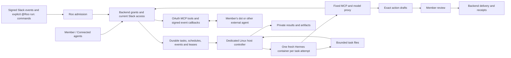

# Proactive Roo with Hermes

This is the host controller and signed Slack admission path for Roo's Hermes
runtime. It is disabled by default. The Django control plane lives in the sibling
`mlai-backend/agent_runtime` application; the active web account interface links
to its Connected agents page through `/platform/agents`.

## Integrated workflow

The controller holds a dedicated claim key. The container receives only two
short-lived, task-bound credentials: one for MLAI tools and one for model calls.
The backend holds upstream Slack and model credentials and rechecks current
membership, grant generation, lease and budget. Public Roo, the worker, external
member agents and Admin Roo have separate authority.

In an enabled and allowlisted public Slack channel, the exact command is
`@Roo run: <instruction>` (Slack delivers the mention as `<@BOT_ID>`). Only the
signature-verified `app_mention` delivery admits a task. The backend resolves the
actual Slack user to one current personal OAuth connection and one eligible
Hermes grant. Ambiguous or missing mappings fail closed. The duplicate `message`
delivery is suppressed. Ordinary messages only create metadata wake-up hints;
task tools fetch content under the member's live permissions.

## Controls and boundaries

- The backend owns schedules, event cursors, source consent, cancellation,
  revocation, action review, model budgets and private results.
- Hermes runs through the pinned ACP adapter. Its built-in global scheduler and
  persistent cross-user memory are not the source of authority. A responsibility
  can receive a bounded history of prior outcomes from the same live grant.
- Task containers use a read-only root, no capabilities or Docker socket,
  bounded CPU/memory/processes, enforced XFS byte/inode quotas, and internal
  networks. One controller and one running task are supported per dedicated VM.
- Permission prompts remain denied. A blocked command produces display-only
  review details; approving and resuming arbitrary shell commands is not enabled.
- Public-web access is a separate grant and operator flag with an approved-host
  HTTPS proxy. It has no member browser cookies. Authenticated browser takeover
  is an experimental, disabled sidecar and is not connected to this controller.
- The source adapter currently supports explicitly allowed public Slack channels
  through the member's own OAuth connection. Private channels, DMs, native MLAI
  Chat relay access and organisational service-account grants are not enabled.
- Message drafts require exact owner review. Automatic public notifications and
  arbitrary unattended writes are not enabled. Results are available in Connected
  agents; the member can create schedules and event monitors there.

MCP tools and the MCP Events adapter are implemented for external clients.
Compatibility with a live dot or another provider still requires an eligible
account, a registered OAuth client and an end-to-end pilot.

## Running and validation

Use the dedicated environment in `.env.hermes.example`; never load the existing
Public/Admin Roo environment into the controller. Image build, proxy, storage,
firewall and systemd instructions are in
[`../../hermes/OPERATIONS.md`](../../hermes/OPERATIONS.md).

`python -m roo.proactive.worker --check` validates the configured host boundary
without claiming work. `--once` claims at most one task. Normal operation polls
the backend and keeps a live lease; cancellation or lease loss stops and removes
the container before output is inspected. Artifacts are immutable bounded
snapshots from `/workspace/artifacts`; symlinks, traversal and credential-bearing
outputs are rejected.

Completion callbacks are idempotent. A lost acknowledgement is retried with the
same body. An unresolved result stops the worker and retains a host-only
`completion-pending.json` receipt. `--reconcile` retries that receipt without
rerunning Hermes. Persistent rejection keeps the receipt for operator review.

The implementation has offline tests for the controller, ACP protocol, public
web proxy, storage helper, browser gate, signed admission and backend policy.
No database migration, deployed service, real model request, Slack send, Docker
image run or authenticated browser session was performed during implementation.
The initial migration needs specific approval under the backend's contributor
rules before database integration tests or enablement. A deployment host and
staging configuration must also be selected.
